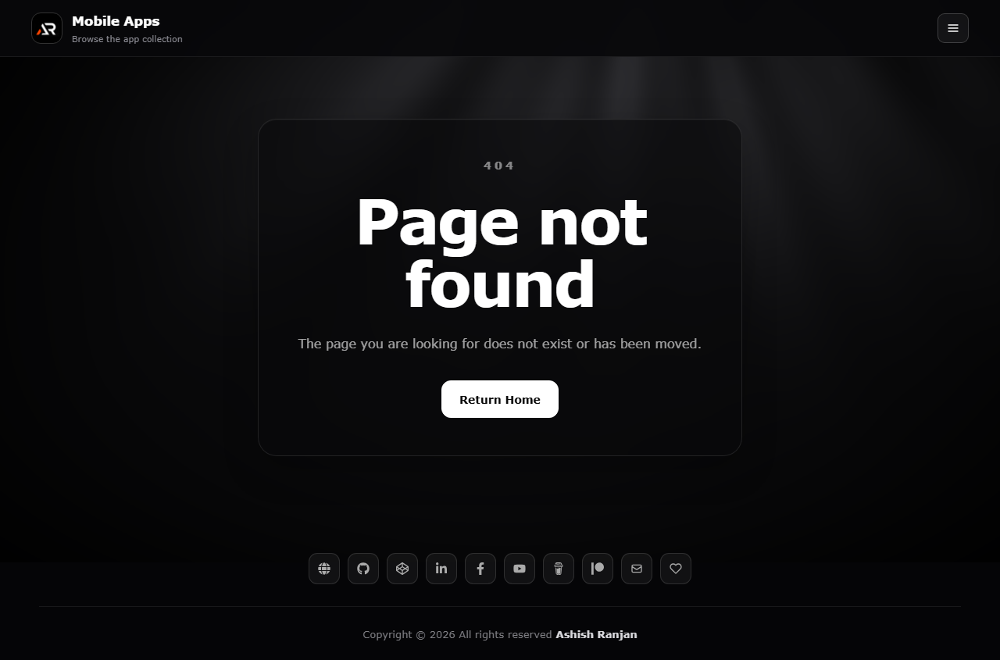

# React Firebase Auth

A responsive React authentication example powered by Firebase Authentication. It includes registration, login, password reset and a protected dashboard route.

## Features

- Firebase email and password registration and login
- Password reset flow with clear success and error states
- Protected dashboard route with sign-out confirmation
- Responsive fixed header, icon-only footer and accessible navigation
- Floating go-to-top control with smooth scrolling
- GitHub Pages deployment configuration

## Tech stack

React, Create React App, Firebase Authentication, React Router, Material UI, Sass, SweetAlert2 and react-icons.

## Firebase setup

1. Create a Firebase project, register a Web app, and enable Email/Password Authentication.
2. Copy `.env.example` to `.env` and replace each placeholder with the Firebase Web app config values.
3. Add `localhost` and `a2rp.github.io` under Firebase Authentication's authorized domains.
4. Restart the development server after changing `.env` values. For deployment, provide the same values to the build environment before running `npm run deploy`.

The Firebase Web app config is included in the built frontend. Firebase service API keys identify the project; they are not authorization credentials. Never put Firebase Admin SDK service-account keys or other private server credentials in this frontend. See [Firebase's API key guidance](https://firebase.google.com/docs/projects/api-keys).

## Run locally

npm install
npm start

Build and deploy:

npm run build
npm run deploy

## Deployment

Live: https://a2rp.github.io/react-firebase-auth/

## Links

- Portfolio: https://www.ashishranjan.net/
- GitHub: https://github.com/a2rp
- CodePen: https://codepen.io/ash1198
- LinkedIn: https://www.linkedin.com/in/aashishranjan
- Facebook: https://www.facebook.com/theash.ashish/
- YouTube: https://www.youtube.com/@ashishranjan-ashz?sub_confirmation=1
- Email: mailto:ash.ranjan09@gmail.com

## Support

- Support: https://a2rp-donation-page.netlify.app/
- Buy Me a Coffee: https://buymeacoffee.com/a2rp
- Patreon: https://patreon.com/a2rp
